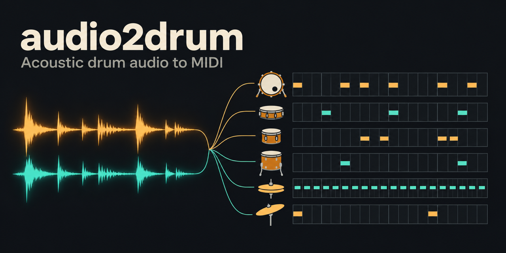

# audio2drum

Script untuk mengkonversi **suara drum akustik** (bukan full music) menjadi MIDI dengan elemen terpisah:
**kick, snare, tom rack, tom floor, hi-hat, crash**.

*Converts acoustic drum audio (drums only, not a full mix) into MIDI with separate kick, snare,
rack tom, floor tom, hi-hat and crash notes.*

> **Catatan: semua not memakai peta MIDI Addictive Drums 2 (XLN Audio).** Untuk drum sampler lain,
> sesuaikan nomor not di bagian *Peta not* (konstanta di awal `audio2drum.py`).

Not ditulis di peta **Addictive Drums 2**, tepat di posisi transient tiap pukulan (akurasi rata-rata < 1 ms
pada tes sintetis). Bisa dipakai dari command line atau langsung dari **REAPER** lewat ReaScript.

## Cara kerja

Tidak memakai neural network. Setiap pukulan dikenali dari warna suaranya:

| Elemen | Ciri yang dipakai |
|---|---|
| **Kick** | low (30–90 Hz) kuat dan langsung mati (kering), walau body 90–300 Hz-nya tebal |
| **Snare** | ada *crack* (300–1500 Hz) + desis senar (2.5–8 kHz), atau resonansi 200–300 Hz milik pukulan itu sendiri |
| **Tom** | low/body kuat, berdengung lebih lama dari kick, tanpa crack; rack vs floor dipisah dari pitch |
| **Hi-hat** | desis terutama di atas 8 kHz; closed / half-open / open dari panjang decay; aksen tipis tetap hat |
| **Crash** | desis 2.5–8 kHz yang lebar dan berdengung (> ~1 detik) |
| **Unknown** | transient yang terdengar tapi tidak cocok aturan mana pun → not **34** (2 di bawah kick), tidak dibuang |

Posisi not: onset dideteksi dulu, lalu digeser ke awal transient yang sebenarnya (resolusi 0.25 ms).
Onset ganda / onset yang terlalu cepat dari detektor digabung ke pukulan aslinya.

Mode **stems** (opsional): kalau ada file stem terpisah (`<nama>_kick.wav`, `_snare`, `_toms`, `_hihat`,
`_cymbals`, atau `kick.wav` … dari alat separasi drum), tiap stem dibaca sebagai satu instrumen.

## Peta not (Addictive Drums 2)

| Elemen | Not |
|---|---|
| Kick | 36 |
| Snare | 38 |
| Hi-hat closed / half-open / open | 49 / 54 / 56 |
| Crash | 77 |
| Ride | 60 |
| Tom 1 (high) → Tom 4 (floor) | 71, 69, 67, 65 |
| Unknown | 34 |

## Instalasi

Butuh Python 3.10+.

```bash
python3 -m venv venv
venv/bin/pip install -r requirements.txt
```

### Di REAPER

1. Salin `audio2drum.py` dan `Drum audio to MIDI (AD2).lua` ke satu folder di
   `REAPER/Scripts/` (misalnya `Scripts/DrumToMIDI/`), lalu buat `venv` di folder yang sama (perintah di atas).
2. *Actions → Show action list → New action → Load ReaScript…* → pilih file `.lua`.
3. Pilih item audio drum, jalankan action-nya. Dialog yang muncul:
   - **Birama**: 4/4, 6/8, …
   - **Downbeat** (opsional): detik bar 1 di dalam item
   - **BPM tetap** (opsional)
   - **Atur tempo project** (default `n`)
   - **Quantize 1/16** (default `n` = not tepat di transient)
4. Script menambah track baru berisi item MIDI yang sejajar dengan audio. Route track itu ke drum
   sampler Anda (peta not di atas).

### Command line

```bash
venv/bin/python audio2drum.py drum.wav drum.mid --no-quantize
```

Opsi: `--meter 4/4`, `--bpm N`, `--anchor SEC`, `--grid auto|fixed|map`, `--stems DIR`, `--no-stems`,
`--no-quantize`, `--notes out.txt` (teks untuk ReaScript).

Laporan di terminal menampilkan grid per 1/16 (`K` kick, `S` snare, `1`–`4` tom, `h/o/O` hat,
`C` crash, `?` unknown, `~` flam).

## Tes

```bash
venv/bin/python test_timing.py --no-quantize
```

Membuat groove sintetis dengan waktu pukulan yang diketahui, lalu mengukur selisih posisi not.

## Keterbatasan

- Untuk **drum saja**. Pada lagu penuh, bass/gitar/vokal ikut terbaca; pisahkan drum dulu (stems).
- Aturan dikalibrasi dari beberapa rekaman (live, produksi, klip latihan); kit atau mix yang sangat
  berbeda bisa salah baca. Bunyi yang ragu masuk ke not 34 supaya mudah dirapikan manual.
- Pemisahan tom rack/floor bergantung pada jarak pitch antar tom; tom yang tuning-nya rapat bisa
  tergabung jadi satu.
- Ghost note yang sangat pelan bisa terlewat atau masuk unknown.

## Lisensi

[MIT](LICENSE)
